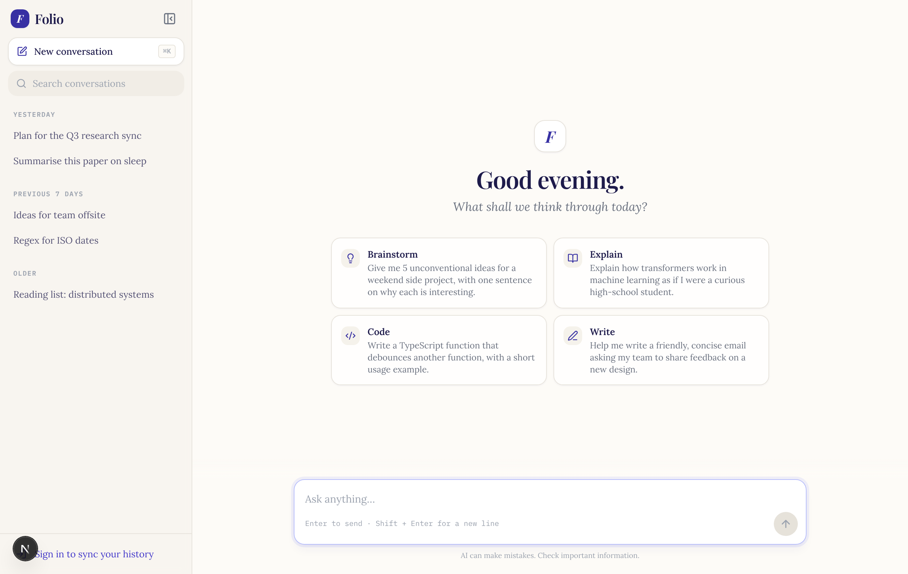

# Folio

A calm, paper-inspired AI chat app built with Next.js, Tailwind and Convex Auth.



## Getting started

```bash
npm install
npm run dev
```

Open [http://localhost:3000](http://localhost:3000).

### Environment

Create `.env.local` (all optional in development):

| Variable | Purpose |
| --- | --- |
| `OPENROUTER_API_KEY` | Real model replies via OpenRouter. Without it, dev uses **mock mode**. |
| `OPENROUTER_MODEL` | Override the model (default `x-ai/grok-4.1-fast:free`). |
| `MOCK_CHAT=1` | Force mock replies even when a key is set. |
| `NEXT_PUBLIC_CONVEX_URL` | Enables sign in / sign up via Convex Auth. |

### Mock mode

With no API key, the chat streams canned replies chosen by keywords in your message, so every part of the UI can be tried:

| Include | Reply |
| --- | --- |
| `code`, `function` | Code blocks with copy buttons |
| `table`, `compare` | Markdown table |
| `idea`, `brainstorm` | Numbered list |
| `explain`, `how`, `why` | Long structured answer |
| `email`, `write` | Drafted email |
| `error` | Failed request → retry flow |
| `slow` | Very slow stream → try **Stop** / **Esc** |

### Shortcuts

- **⌘K / Ctrl+K** — new conversation
- **⌘\\ / Ctrl+\\** — toggle sidebar
- **/** — focus the composer
- **Enter** send · **Shift+Enter** new line · **Esc** stop generating

Chats are saved in `localStorage`, so they survive a refresh.
